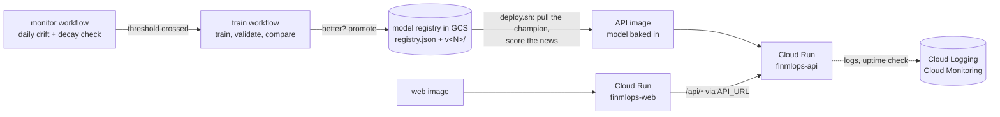

# Deploying FinMLOps

The model is deployed to the **cloud: Google Cloud Platform, Cloud Run**. Two Cloud Run services:

| Service | What it is | Image |
|---|---|---|
| `finmlops-api` | FastAPI (`frontend/server.py`): runs the champion FinBERT model, serves the scored news and `/api/predict` | `Dockerfile.api` |
| `finmlops-web` | the Next.js site (`web/`); forwards every `/api/*` request to the API through `API_URL` | `web/Dockerfile` |

Why Cloud Run: both parts are stateless containers, it scales to zero when nobody visits (close to free for a student
project), gives each service an HTTPS URL, and logs to Cloud Logging and Cloud Monitoring with no setup. The model
needs about 2 GB of memory, which Cloud Functions can't give comfortably, and a single model doesn't need Kubernetes.

## How it fits together



- **The model registry the deployment reads is the GCS bucket** (`MODEL_BUCKET`). When the pipeline promotes a model it
  copies its files to `gs://<bucket>/models/finbert-sentiment/v<N>/` and writes `registry.json` there, naming the
  champion and every version's scores (`scripts/registry.py`).
- **Deploying pulls the champion named in `registry.json`**, scores all the news with it, and bakes both into the API
  image (`deploy/bundle.sh`, `Dockerfile.api`). The running service needs no MLflow, no bucket access and no internet.

## Files

| File | Does |
|---|---|
| `deploy/setup.sh` | one-time project setup: APIs, Artifact Registry, a deploy service account with only the roles it needs |
| `deploy/deploy.sh` | the whole deploy, start to finish (the CI workflow runs this same script) |
| `deploy/bundle.sh` | pull the news snapshot and the champion, score the news (what the API image bakes in) |
| `Dockerfile.api`, `Dockerfile.api.dockerignore` | the API image; its own ignore file, so the training image is untouched |
| `docker-compose.yaml` | both services on your machine, from the same Dockerfiles |
| `scripts/deploy.py` | `pull` the champion from the registry, `check` (smoke test) the deployed services |
| `scripts/monitor.py` | drift and decay checks against thresholds in `scripts/config.py` |
| `.github/workflows/deploy.yml` | CD: deploy on a promotion, on app code changes, or by hand |
| `.github/workflows/monitor.yml` | daily monitoring; starts retraining when a threshold is crossed |
| `.github/workflows/train.yml` | CI for the model; a promotion now calls `deploy.yml` |

## 1. Set up the environment (once)

On a fresh machine install: [Google Cloud CLI](https://cloud.google.com/sdk/docs/install),
[Docker](https://docs.docker.com/get-docker/), [uv](https://docs.astral.sh/uv/getting-started/installation/) and git.

```bash
git clone https://github.com/FinMLOps/finmlops-model-dev.git && cd finmlops-model-dev
uv sync --extra cpu
gcloud auth login
gcloud auth application-default login        # lets DVC and the scripts read the buckets
```

Your Google account needs read access to the DVC bucket (`gs://finmlops-pipeline-dvc`) and the model bucket, and
permission to deploy in the project. Then prepare the project once:

```bash
export GCP_PROJECT=<project-id> MODEL_BUCKET=<model-bucket> DVC_BUCKET=finmlops-pipeline-dvc
deploy/setup.sh
```

It enables Cloud Run, Artifact Registry and Cloud Monitoring, creates the `finmlops` image repository and a
`finmlops-deployer` service account (or adds the roles to `SERVICE_ACCOUNT` if you set it), and prints what to add to
GitHub. If the buckets live in a teammate's project, the bucket lines need someone with access to those buckets.

The registry needs a champion in it the first time. If the bucket has no `registry.json` yet, publish the current one
from a machine with the MLflow registry (`mlflow.db`, `mlruns/`):

```bash
uv run python -m scripts.registry push        # copy the champion's files to MODEL_BUCKET
uv run python -m scripts.registry publish     # write registry.json
```

## 2. Deploy

```bash
GCP_PROJECT=<project-id> MODEL_BUCKET=<model-bucket> deploy/deploy.sh
```

Optional settings: `GCP_REGION` (default `us-east1`), `MIN_INSTANCES=1` (no cold starts, costs a few dollars a month),
`API_SERVICE` / `WEB_SERVICE` (service names), `TAG` (image tag, default the commit). It prints each step:

1. bundle: the news snapshot (DVC), the champion from the registry, the news scored by it (scoring on CPU is the slow part)
2. build both images and push them to `<region>-docker.pkg.dev/<project>/finmlops`
3. deploy `finmlops-api`, then `finmlops-web` with `API_URL` pointing at it
4. smoke test both live services, and create the uptime check if it isn't there yet

and ends with `deployed: site https://finmlops-web-… · API https://finmlops-api-…`.

## 3. Verify

```bash
API=$(gcloud run services describe finmlops-api --region us-east1 --format 'value(status.url)')
curl "$API/api/health"                         # {"status":"ok","champion":"…","model_loaded":true,"news_as_of":"…"}
curl -X POST "$API/api/predict" -H 'content-type: application/json' \
     -d '{"text": "Nvidia beats revenue estimates as data center sales surge"}'
uv run python -m scripts.deploy check "$API" "<site URL>"   # what deploy.sh runs: health, a prediction, the site
```

Then open the site URL: the dashboard, the news, the analyzer (runs the deployed champion) and the Models page
(served from `registry.json`).

## 4. CI/CD (GitHub Actions)

Add to the repo (Settings → Secrets and variables → Actions); `deploy/setup.sh` prints the values:

| Name | Kind | What |
|---|---|---|
| `GCP_SA_KEY` | secret | JSON key of the deploy service account (also used by train for DVC and the model bucket) |
| `GCP_PROJECT` | variable | project to deploy to |
| `GCP_REGION` | variable | optional, default `us-east1` |
| `MODEL_BUCKET` | variable | the model registry bucket |
| `GMAIL_USERNAME`, `GMAIL_APP_PASSWORD`, `RECIPIENTS` | secrets | email notifications (already used by the other workflows) |

What triggers what:

- **A new model version**: `train.yml` trains a challenger and promotes it only if it passes the champion rule. A
  promotion pushes it to the registry, publishes `registry.json` and calls `deploy.yml`, which redeploys with it.
- **App code changes** on `main` (`web/`, `frontend/`, `Dockerfile.api`, `deploy/`): `deploy.yml` redeploys.
- **By hand**: Actions → deploy → Run workflow.

Every deploy writes a summary (site, API, champion, commit) to the run page and emails success or failure.

## 5. Logs and monitoring

- **Logs**: every API request is one structured JSON line (method, path, status, latency) and every Analyzer
  prediction one `prediction` event (label, confidence, version; the headline isn't logged). In Cloud Logging, or:
  `gcloud run services logs read finmlops-api --region us-east1`
- **Uptime**: `deploy.sh` creates a Cloud Monitoring uptime check on `/api/health` every 5 minutes. If your gcloud
  version can't, add it in the console: Monitoring → Uptime checks → create, HTTPS, the API host, path `/api/health`.
  Add an alerting policy on it to get emailed when the API is down.
- **Cloud Run metrics** (requests, latency, errors, memory, instances) are on each service's Metrics tab.

## 6. Model monitoring and retraining

`monitor.yml` runs every day (and by hand). It gets the **newest news** from the data pipeline (`dvc update`), pulls
the **deployed champion** from the registry and runs `scripts/monitor.py`:

| Check | How | Retrain when |
|---|---|---|
| Data drift | population stability index (PSI) between the training news and the newest news, for the ticker mix, source mix and headline length | any PSI > `DRIFT_PSI` (0.2) |
| Model decay | the champion's macro F1 on the newest Marketaux headlines vs. on the held-out benchmark window's (both labeled from the sentiment score, neither trained on) | it drops more than `DECAY_DROP` (0.10) |

Only the news after the benchmark window counts as new, and fewer than `MIN_MONITOR_ROWS` (50) new rows is too little
to judge. The report goes to `outputs/monitor.json` (kept as a workflow artifact and shown on the run page). When a
threshold is crossed the team is emailed and `train.yml` starts with `update_data`, so the challenger trains on the
newest news; it is promoted (and deployed) only if it beats the champion, otherwise the champion stays. Every step
emails: retraining triggered (monitor), the pipeline's decision (train), the deploy result (deploy).

> **Known limitation, a team decision**: `scripts/config.py` freezes the benchmark window (`TEST_START`, `TEST_END`)
> and ignores news after `TEST_END` for training until the benchmark is deliberately re-cut. So a retrain triggered by
> drift currently re-runs on the same training window. Moving the window forward is a modeling choice (it changes the
> test set every model is compared on), so it isn't automated here.

## 7. Run it locally

The same two containers on your machine:

```bash
MODEL_BUCKET=<model-bucket> deploy/bundle.sh   # the champion and the scored news
docker compose up --build                       # site http://localhost:3000, API http://localhost:8000/api/health
```

`bundle.sh` rescores `outputs/predictions.parquet`, which is committed for the local dashboard; commit the new one or
`git restore outputs/` afterwards.

## 8. Recording the video (fresh environment)

A 5–10 minute walkthrough on a clean machine or VM:

1. Install gcloud, Docker, uv and git; clone the repo; `uv sync --extra cpu`; `gcloud auth login` and
   `gcloud auth application-default login` (section 1).
2. `deploy/setup.sh`, then `deploy/deploy.sh` (section 2); speed up the scoring part in editing.
3. Verify: `curl` the health and predict endpoints, open the site and use the analyzer (section 3).
4. Show CI/CD: the deploy workflow run, its summary and email; the train workflow calling deploy after a promotion.
5. Show monitoring: the Cloud Run logs and uptime check, then run the monitor workflow by hand and open its report.

## Troubleshooting

| Symptom | Fix |
|---|---|
| `registry.json` not found in the bucket | publish the champion once (end of section 1) |
| `dvc pull` permission denied | your account (or `GCP_SA_KEY`'s) needs read access to `gs://finmlops-pipeline-dvc` |
| the API returns 503 or the container restarts | out of memory: raise `--memory` in `deploy.sh` to `4Gi` |
| the first Analyzer request is slow | a cold start loads the model; set `MIN_INSTANCES=1` |
| the site says the API isn't reachable | the web service's `API_URL` is wrong: redeploy, or `gcloud run services update finmlops-web --set-env-vars API_URL=<api url>` |
