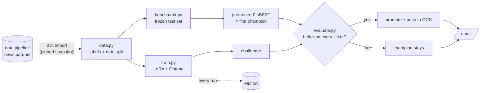

# FinMLOps Model Development

[](https://github.com/FinMLOps/finmlops-model-dev/actions/workflows/pytest.yml)

This is the model stage of our FinMLOps project. It takes the cleaned financial news for the Magnificent 7 (AAPL, MSFT, NVDA, GOOGL, META, AMZN, TSLA) from our [data pipeline](https://github.com/FinMLOps/finmlops-data-pipeline) and fine-tunes [FinBERT](https://huggingface.co/ProsusAI/finbert) to classify each headline as positive, neutral or negative. Every run is tracked in MLflow, and a new model only replaces the current one (the "champion") when it's actually better.

> [!IMPORTANT]
> - We use [`uv`](https://docs.astral.sh/uv/), which is superior to `pip`.
> - Python is pinned to `3.12` (in [`.python-version`](.python-version)).

## Team

| Name | GitHub | Email |
|---|---|---|
| Nina Gharachorloo | [@ninaghar](https://github.com/ninaghar) | [gharachorloo.ni](mailto:gharachorloo.ni@northeastern.edu) |
| Aayam Raj Shakya | [@aayamrajshakya](https://github.com/aayamrajshakya) | [shakya.aa](mailto:shakya.aa@northeastern.edu) |
| Geethanjali Ravichandra | [@alpha2505](https://github.com/Alpha2505) | [ravichandra.g](mailto:ravichandra.g@northeastern.edu) |
| Kshitij Maurya | [@kmaurya9](https://github.com/kmaurya9) | [maurya.k](mailto:maurya.k@northeastern.edu) |
| Keshav Girish Adkar | [@keshav8087](https://github.com/KESHAV8087) | [adkar.k](mailto:adkar.k@northeastern.edu) |

## How it works



**Data** ([`scripts/data.py`](scripts/data.py)) loads `news.parquet` and checks it has the columns and tickers we expect. Marketaux gives each article a sentiment score for each ticker (-1 to 1), and we turn that into a label: above +0.15 is positive, below -0.15 is negative, anything in between is neutral. The score is then dropped so the model can't cheat by reading it. We split by date, not randomly, because news about the same event comes out in bursts and a random split would put near-copies of the same story in both train and test. So the model trains on older news and is tested on newer news, which is also how it would be used for real.

**Benchmark** ([`scripts/benchmark.py`](scripts/benchmark.py)) freezes the test set: Marketaux news from 6 Nov up to 12 Nov 2026. The rows are saved once as `data/benchmark_20261106_20261112.parquet` and never rebuilt, so every model is compared on exactly the same articles, even after we pull newer data. Only the rows are frozen: the labels are made again from the stored Marketaux score every time, so they always follow the current cut-off. Pretrained FinBERT scores it first, and that score is the baseline to beat. It also shows how much the results move if the ±0.15 cut-off were 0.10 or 0.25, and how often Marketaux agrees with our own hand labels.

**Training** ([`scripts/train.py`](scripts/train.py)) fine-tunes FinBERT with [LoRA](https://huggingface.co/docs/peft), which only trains small adapter layers instead of the whole model, so it's fast and fits in the memory of an ordinary GPU. Most of our labels are positive, so the loss gives the rarer negative and neutral rows more weight, otherwise the model would learn to just say "positive". Training also uses a learning-rate warmup, gradient clipping and weight decay, and keeps the epoch that scored best on the validation set. An [Optuna](https://optuna.org) search tries different learning rates, LoRA sizes, dropout and epochs, scored on the validation set only (never the test set).

**Evaluation** ([`scripts/evaluate.py`](scripts/evaluate.py)) reports macro F1 (our main metric, since it treats the three classes equally), precision, recall, accuracy, and accuracy for each ticker.

**Registry** ([`scripts/registry.py`](scripts/registry.py)) keeps every model version in the MLflow model registry. The current best one has the `champion` alias. A promoted model can also be copied to a Google Cloud Storage bucket.

**Pipeline** ([`scripts/pipeline.py`](scripts/pipeline.py)) runs the whole thing with one command and emails the result. See [the champion rule](#the-champion-rule) below.

**Analysis** ([`scripts/analysis.py`](scripts/analysis.py)) makes the charts (confusion matrices, champion vs challenger) and the sensitivity analysis: which words push a headline toward positive or negative (SHAP), whether the summary helps compared with the title alone, and which hyperparameters mattered most in the Optuna search.

## The champion rule

A new model (the challenger) only replaces the champion if:

1. its macro F1 is at least `0.6` (otherwise it fails validation, and the pipeline exits with an error), and
2. its macro F1 is higher than the champion's, and
3. it isn't worse than the champion for **any** ticker (we allow a 0.02 drop, since some tickers only have a few test rows).

If it loses, the champion simply stays, so there's nothing to roll back. On the very first run there's no champion yet, so the pipeline scores pretrained FinBERT and makes it the champion first.

> [!NOTE]
> All these numbers (the label cut-off, the test dates, the 0.6 floor, the tolerance, the default hyperparameters) live in one place: [`scripts/config.py`](scripts/config.py).

## Quick start

You need access to our DVC bucket (see [Getting the data](#getting-the-data)).

**1. Clone the repo and install everything** (run only one of the two `uv sync` lines):

```bash
git clone https://github.com/FinMLOps/finmlops-model-dev.git
cd finmlops-model-dev
uv sync --extra gpu     # Windows/Linux with an NVIDIA GPU
uv sync --extra cpu     # everything else, including Macs (Apple GPU still used)
```

**2. Get the data:**

```bash
gcloud auth application-default login   # the Google account that has access to the bucket
uv run dvc pull
```

**3. Run the pipeline:**

```bash
uv run python -m scripts.pipeline            # baseline (first time) + train + compare + promote
uv run python -m scripts.pipeline --tune     # same, but run the Optuna search first
```

**4. Look at the runs:**

```bash
uv run mlflow ui --backend-store-uri sqlite:///mlflow.db
```

Then open http://localhost:5000.

> [!WARNING]
> Train on a machine with a GPU (an NVIDIA one, or an Apple Silicon Mac). Without one it still works, just much slower (the Optuna search can take hours). The first run also downloads FinBERT (about 440 MB).

> [!NOTE]
> The scripts pick the hardware themselves: an NVIDIA GPU first (training in mixed precision, bf16 or fp16 depending on the card), then an Apple Silicon GPU, then the CPU. To force one, put `TORCH_DEVICE=cpu` (or `mps`, `cuda`) in `.env`. Which hardware a run used is logged in MLflow with the run.

> [!IMPORTANT]
> Always run the scripts from the repo folder with `python -m scripts.<name>`. Running `python data.py` from inside `scripts/` fails with `No module named 'scripts'`.

### Running each step on its own

```bash
uv run python -m scripts.train baseline      # score + register pretrained FinBERT
uv run python -m scripts.train               # one LoRA run with the default settings
uv run python -m scripts.train tune          # only the Optuna search (add a number for more trials: tune 20)
uv run python -m scripts.analysis            # SHAP, title vs summary, hyperparameter importance
uv run python -m scripts.data sample-gold    # rows for hand-labeling (see below)
uv run python -m scripts.benchmark           # how often Marketaux agrees with our hand labels
```

## Getting the data

`news.parquet` comes from the data pipeline's [`scripts/preprocess.py`](https://github.com/FinMLOps/finmlops-data-pipeline/blob/main/scripts/preprocess.py) and is versioned with DVC there. This repo imports it with `dvc import`, and [`data/news.parquet.dvc`](data/news.parquet.dvc) pins the exact data pipeline commit it came from. Every MLflow run logs that commit (`data_snapshot`), so we can always tell which data a model was trained on. The parquet itself isn't in git.

The data lives in a Google Cloud Storage bucket (`gs://finmlops-pipeline-dvc`) in our teammate Kshitij's personal Google Cloud account. Ask him to add your email, then log in with `gcloud auth application-default login`. The data pipeline's [DVC guide](https://github.com/FinMLOps/finmlops-data-pipeline/blob/main/docs/DVC_GUIDE.md) has the details and troubleshooting.

To move to a newer snapshot after the data pipeline publishes one:

```bash
uv run dvc update data/news.parquet.dvc
git commit -m "update to the latest data snapshot" data/news.parquet.dvc
```

> [!NOTE]
> A new snapshot doesn't change the frozen benchmark. Rows after 12 Nov are left out of both training and testing until we move the test dates in [`scripts/config.py`](scripts/config.py) on purpose.

## Hand-labeled gold set

Marketaux's scores are automatic, so we don't fully trust them. Before we rely on them, we hand-label a sample and check how often Marketaux agrees with us:

```bash
uv run python -m scripts.data sample-gold
```

This writes `data/gold_todo.csv` (it won't overwrite one that's already there, since it may hold your labels; add `--force` if you really want a fresh one): 100 Finnhub headlines per ticker (Finnhub rows are never trained on) plus up to 15 Marketaux headlines per ticker from the benchmark window. The source and Marketaux's score are left out, so they can't sway whoever labels. For each row fill in:

- `label`: `negative`, `neutral` or `positive`
- `mixed_signal`: `1` if the headline pulls both ways (like "revenue grew but missed estimates"), otherwise leave it empty

Save it as `data/gold.csv`. Small slips like `Positive ` or `yes` are fine, but every row needs a label. Gold rows are never used for training. From then on the gold set decides promotion instead of the benchmark, mixed-signal headlines get their own accuracy, and `uv run python -m scripts.benchmark` shows how often Marketaux agrees with us.

## Email alerts

The pipeline emails the team when a challenger is promoted, when the champion stays, when validation fails, or when the pipeline crashes. It uses the same Gmail setup as the data pipeline. Put these in a `.env` file in the repo folder:

```text
GMAIL_USERNAME=finmlops.alerts@gmail.com
GMAIL_APP_PASSWORD=abcd efgh ijkl mnop
ALERT_RECIPIENTS=you@northeastern.edu,teammate@northeastern.edu
```

If they're missing, the pipeline still runs and just logs a warning. Two more optional settings go in the same file: `MLFLOW_TRACKING_URI` (a shared MLflow server instead of the local `mlflow.db`) and `MODEL_BUCKET` (the GCS bucket a promoted model is copied to).

> [!CAUTION]
> `.env` holds real passwords. It's in [`.gitignore`](.gitignore), so never force-add it or paste its contents anywhere.

## Tests

```bash
uv run pytest                              # everything
uv run pytest tests/test_data.py           # or one file
```

> [!NOTE]
> The tests never download FinBERT, train anything, touch MLflow or GCS, or send real emails. Those are all mocked or faked with tiny tables, so the tests run in seconds and work offline. CI runs them on every push and PR to `main` and emails us if they fail ([`.github/workflows/pytest.yml`](.github/workflows/pytest.yml)).

## Project structure

```text
finmlops-model-dev/
├── .github/workflows/
│   ├── pytest.yml            # runs the tests in CI
│   └── claude.yml            # Claude PR review assistant
├── data/
│   ├── news.parquet.dvc      # pins the data pipeline snapshot we use (in git)
│   ├── news.parquet          # the data itself (from DVC, not in git)
│   └── benchmark_20261106_20261112.parquet   # the frozen test set (made on the first run)
├── scripts/
│   ├── config.py             # every setting in one place
│   ├── data.py               # loading, labels, date split, gold set
│   ├── hardware.py           # picks NVIDIA GPU / Apple Silicon / CPU and mixed precision
│   ├── benchmark.py          # frozen test set + pretrained FinBERT baseline
│   ├── train.py              # baseline, LoRA fine-tuning, Optuna search
│   ├── evaluate.py           # predictions, metrics, the champion rule
│   ├── registry.py           # MLflow model registry + GCS push
│   ├── analysis.py           # charts and sensitivity analysis
│   └── pipeline.py           # the whole flow in one command, with email alerts
├── tests/                    # offline tests for the scripts' logic
├── pyproject.toml
└── uv.lock
```
