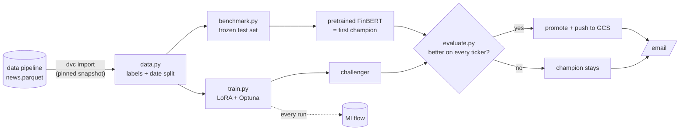

# FinMLOps Model Development

[](https://github.com/FinMLOps/finmlops-model-dev/actions/workflows/pytest.yml)

This is the model stage of our FinMLOps project. It takes the cleaned financial news for the Magnificent 7 (AAPL, MSFT, NVDA, GOOGL, META, AMZN, TSLA) from our [data pipeline](https://github.com/FinMLOps/finmlops-data-pipeline) and fine-tunes [FinBERT](https://huggingface.co/ProsusAI/finbert) to classify each headline as positive, neutral or negative. Every run is tracked in MLflow, and a new model only replaces the current one (the "champion") when it's actually better.

> [!IMPORTANT]
> - We use [`uv`](https://docs.astral.sh/uv/), which is superior to `pip`.
> - Python is pinned to `3.12` (in [`.python-version`](.python-version)).

## Team

| Name | GitHub | Email |
|---|---|---|
| Nina Gharachorloo | [@ninaghar](https://github.com/ninaghar) | [gharachorloo.ni](mailto:gharachorloo.ni@northeastern.edu) |
| Aayam Raj Shakya | [@aayamrajshakya](https://github.com/aayamrajshakya) | [shakya.aa](mailto:shakya.aa@northeastern.edu) |
| Geethanjali Ravichandra | [@alpha2505](https://github.com/Alpha2505) | [ravichandra.g](mailto:ravichandra.g@northeastern.edu) |
| Kshitij Maurya | [@kmaurya9](https://github.com/kmaurya9) | [maurya.k](mailto:maurya.k@northeastern.edu) |
| Keshav Girish Adkar | [@keshav8087](https://github.com/KESHAV8087) | [adkar.k](mailto:adkar.k@northeastern.edu) |

## How it works



**Data** ([`scripts/data.py`](scripts/data.py)) loads `news.parquet` and checks it has the columns and tickers we expect. Marketaux gives each article a sentiment score for each ticker (-1 to 1), and we turn that into a label: above +0.15 is positive, below -0.15 is negative, anything in between is neutral. The score is then dropped so the model can't cheat by reading it. We split by date, not randomly, because news about the same event comes out in bursts and a random split would put near-copies of the same story in both train and test. So the model trains on older news and is tested on newer news, which is also how it would be used for real. News from the 24 hours before the test window is used for neither (a gap, so a story that breaks the day before can't land on both sides), and any training row that repeats a test headline or URL, from either source, is dropped.

The model always reads the ticker and company in front of the text, like `NVDA (NVIDIA): Nvidia beats estimates...`. One article about two companies is two rows with the same text, and 38% of our Marketaux articles mention more than one ticker, often with a different sentiment for each (good for NVDA, bad for AMD). Without the ticker the model would see the same input with two different labels.

**Which data does what.** Only Marketaux comes with labels, but 94% of our news (and of what the dashboard shows) is Finnhub, mostly from Yahoo. So we train where the labels are and test where the users are:

| | Data | Labels |
|---|---|---|
| Training | Marketaux, before the test window | Marketaux score (plus LLM labels for Finnhub, if they pass the gold check, see below) |
| Validation (best epoch, Optuna) | Marketaux, the newest part before the test window | Marketaux score |
| **Test that decides promotion** | **Gold set from the test window, mostly Finnhub** | LLM labels (Gemini), see [Gold set](#gold-set) |
| Secondary test | Marketaux, 6 to 12 Nov (the benchmark) | Marketaux score |

**Benchmark** ([`scripts/benchmark.py`](scripts/benchmark.py)) freezes the test set: Marketaux news from 6 Nov up to 12 Nov 2026. The rows are saved once as `data/benchmark_20261106_20261112.parquet` and never rebuilt, so every model is compared on exactly the same articles, even after we pull newer data. Only the rows are frozen: the labels are made again from the stored Marketaux score every time, so they always follow the current cut-off. Pretrained FinBERT scores it first, and that score is the baseline to beat. It also shows how much the results move if the ±0.15 cut-off were 0.10 or 0.25, and how often Marketaux agrees with the gold labels.

**Training** ([`scripts/train.py`](scripts/train.py)) fine-tunes FinBERT with [LoRA](https://huggingface.co/docs/peft), which only trains small adapter layers instead of the whole model, so it's fast and fits in the memory of an ordinary GPU. Most of our labels are positive, so the loss gives the rarer negative and neutral rows more weight, otherwise the model would learn to just say "positive". Training also uses a learning-rate warmup, gradient clipping and weight decay, and keeps the epoch that scored best on the validation set. An [Optuna](https://optuna.org) search tries different learning rates, LoRA sizes, dropout and epochs, scored on the validation set only (never the test set).

**Evaluation** ([`scripts/evaluate.py`](scripts/evaluate.py)) reports macro F1 (our main metric, since it treats the three classes equally), precision, recall, accuracy, and accuracy for each ticker. Comparing two models, it also works out how sure we can be that one is really better (see [the champion rule](#the-champion-rule)).

**Slices** ([`scripts/slices.py`](scripts/slices.py)) checks whether the model works equally well for every ticker, source, publisher, headline length and (on the gold set) mixed-signal headline, using [Fairlearn](https://fairlearn.org). Every challenger gets a report and charts in MLflow, and if the best and worst slice are more than 0.15 accuracy apart, the email says so and the report suggests what to do about it (more labels for that slice, re-sampling or re-weighting).

**Registry** ([`scripts/registry.py`](scripts/registry.py)) keeps every model version in the MLflow model registry. The current best one has the `champion` alias. A promoted model can also be copied to a Google Cloud Storage bucket.

**Pipeline** ([`scripts/pipeline.py`](scripts/pipeline.py)) runs the whole thing with one command and emails the result. See [the champion rule](#the-champion-rule) below.

**Analysis** ([`scripts/analysis.py`](scripts/analysis.py)) makes the charts (confusion matrices, champion vs challenger) and the sensitivity analysis: which words push a headline toward positive or negative (SHAP), whether the summary helps compared with the title alone, and which hyperparameters mattered most in the Optuna search.

## The champion rule

A new model (the challenger) only replaces the champion if:

1. its macro F1 is at least `0.6` (otherwise it fails validation, and the pipeline exits with an error), and
2. it beats the champion's macro F1 **even at the low end of a 95% confidence interval**, and
3. it isn't worse than the champion for **any** ticker (we allow a 0.02 drop, since some tickers only have a few test rows).

Rule 2 is there because our test sets are small. We resample the test rows 1,000 times and score both models on each resample (a paired bootstrap). With a few hundred rows, a gain of +0.02 can easily be luck: one check gave an interval of -0.05 to +0.09 for exactly that. Only a gain that stays above zero across the interval counts.

If it loses, the champion simply stays, so there's nothing to roll back. On the very first run there's no champion yet, so the pipeline scores pretrained FinBERT and makes it the champion first.

> [!NOTE]
> All these numbers (the label cut-off, the test dates, the 0.6 floor, the tolerance, the default hyperparameters) live in one place: [`scripts/config.py`](scripts/config.py).

## Quick start

You need access to our DVC bucket (see [Getting the data](#getting-the-data)).

**1. Clone the repo and install everything** (run only one of the two `uv sync` lines):

```bash
git clone https://github.com/FinMLOps/finmlops-model-dev.git
cd finmlops-model-dev
uv sync --extra gpu     # Windows/Linux with an NVIDIA GPU
uv sync --extra cpu     # everything else, including Macs (Apple GPU still used)
```

**2. Get the data:**

```bash
gcloud auth application-default login   # the Google account that has access to the bucket
uv run dvc pull
```

**3. Run the pipeline:**

```bash
uv run python -m scripts.pipeline            # baseline (first time) + train + compare + promote
uv run python -m scripts.pipeline --tune     # same, but run the Optuna search first
```

**4. Look at the runs:**

```bash
uv run mlflow ui --backend-store-uri sqlite:///mlflow.db
```

Then open http://localhost:5000.

> [!WARNING]
> Train on a machine with a GPU (an NVIDIA one, or an Apple Silicon Mac). Without one it still works, just much slower (the Optuna search can take hours). The first run also downloads FinBERT (about 440 MB).

> [!NOTE]
> The scripts pick the hardware themselves: an NVIDIA GPU first (training in mixed precision, bf16 or fp16 depending on the card), then an Apple Silicon GPU, then the CPU. To force one, put `TORCH_DEVICE=cpu` (or `mps`, `cuda`) in `.env`. Which hardware a run used is logged in MLflow with the run.

> [!IMPORTANT]
> Always run the scripts from the repo folder with `python -m scripts.<name>`. Running `python data.py` from inside `scripts/` fails with `No module named 'scripts'`.

### Running each step on its own

```bash
uv run python -m scripts.train baseline      # score + register pretrained FinBERT
uv run python -m scripts.train               # one LoRA run with the default settings
uv run python -m scripts.train tune          # only the Optuna search (add a number for more trials: tune 20)
uv run python -m scripts.analysis            # SHAP, title vs summary, hyperparameter importance
uv run python -m scripts.registry push       # copy the champion to MODEL_BUCKET on Google Cloud Storage
uv run python -m scripts.data sample-gold    # rows for hand-labeling (see below)
uv run python -m scripts.benchmark           # agreement: annotators, Marketaux and the LLM vs the gold labels
uv run python -m scripts.llm_labels gold     # LLM labels (see "LLM labels for Finnhub")
```

## Getting the data

`news.parquet` comes from the data pipeline's [`scripts/preprocess.py`](https://github.com/FinMLOps/finmlops-data-pipeline/blob/main/scripts/preprocess.py) and is versioned with DVC there. This repo imports it with `dvc import`, and [`data/news.parquet.dvc`](data/news.parquet.dvc) pins the exact data pipeline commit it came from. Every MLflow run logs that commit (`data_snapshot`), so we can always tell which data a model was trained on. The parquet itself isn't in git.

The data lives in a Google Cloud Storage bucket (`gs://finmlops-pipeline-dvc`) in our teammate Kshitij's personal Google Cloud account. Ask him to add your email, then log in with `gcloud auth application-default login`. The data pipeline's [DVC guide](https://github.com/FinMLOps/finmlops-data-pipeline/blob/main/docs/DVC_GUIDE.md) has the details and troubleshooting.

To move to a newer snapshot after the data pipeline publishes one:

```bash
uv run dvc update data/news.parquet.dvc
git commit -m "update to the latest data snapshot" data/news.parquet.dvc
```

> [!NOTE]
> A new snapshot doesn't change the frozen benchmark. Rows after 12 Nov are left out of both training and testing until we move the test dates in [`scripts/config.py`](scripts/config.py) on purpose.

## Gold set

Marketaux's scores come from Marketaux's own model, so testing on them only shows how well we copy it. The gold set is our ground truth:

> [!IMPORTANT]
> The current `data/gold.csv` (801 rows) was labeled by an LLM, not by hand: Gemini 3.5 Flash (550 rows), Gemini 3.5 Flash-Lite (232) and Qwen 2.5 7B through Ollama (19), as recorded in its `labeled_by` column. The steps below are how to hand-label it; `label_2` hasn't been filled in yet, so the LLM labels haven't been checked against a person.

```bash
uv run python -m scripts.data sample-gold
```

This writes `data/gold_todo.csv` (it won't overwrite one that's already there, since it may hold your labels; add `--force` if you really want a fresh one): about 800 headlines, all from the test window, so the model has never seen anything from that time. That's 100 Finnhub headlines per ticker (what users mostly see) plus up to 15 Marketaux ones per ticker (to check Marketaux against us). The source and Marketaux's score are left out, so they can't sway whoever labels. For each row fill in:

- `label`: `negative`, `neutral` or `positive`, meaning the sentiment **for that ticker**
- `mixed_signal`: `1` if the headline pulls both ways (like "revenue grew but missed estimates"), otherwise leave it empty
- `label_2`: only on rows marked `shared` (about 120): a **second person** labels them without looking at `label`

Save it as `data/gold.csv`. Small slips like `Positive ` or `yes` are fine, but every row needs a `label`. Gold rows are never used for training. From then on the gold set decides promotion instead of the benchmark, and

```bash
uv run python -m scripts.benchmark
```

shows three agreement numbers (Cohen's kappa, where 1 is perfect and 0 is chance): between the two annotators, between Marketaux and us, and between the LLM and us. The annotator number is the ceiling: if two people only agree at 0.7, no model can be judged more precisely than that.

## LLM labels for Finnhub

The 18,000 Finnhub headlines from the training period have no labels. [`scripts/llm_labels.py`](scripts/llm_labels.py) can label them with Gemini (a free key from [Google AI Studio](https://aistudio.google.com/apikey) in `.env` as `GEMINI_API_KEY`), 25 headlines per request, saving after every request so a stopped run picks up where it left off:

```bash
uv run python -m scripts.llm_labels gold --limit 100    # first: how good is the LLM on the gold labels?
uv run python -m scripts.llm_labels train               # then the training-period Finnhub rows
```

Training only uses them if the LLM agrees with the gold set **at least as well as Marketaux does** (or reaches a kappa of 0.6 if Marketaux's agreement can't be measured). Otherwise they're ignored and the log says why. The LLM's labels on the gold rows are only ever used for that check, never for training.

## Email alerts

The pipeline emails the team when a challenger is promoted, when the champion stays, when validation fails, or when the pipeline crashes. It uses the same Gmail setup as the data pipeline. Put these in a `.env` file in the repo folder:

```text
GMAIL_USERNAME=finmlops.alerts@gmail.com
GMAIL_APP_PASSWORD=abcd efgh ijkl mnop
ALERT_RECIPIENTS=you@northeastern.edu,teammate@northeastern.edu
```

If they're missing, the pipeline still runs and just logs a warning. Two more optional settings go in the same file: `MLFLOW_TRACKING_URI` (a shared MLflow server instead of the local `mlflow.db`) and `MODEL_BUCKET` (the GCS bucket a promoted model is copied to).

> [!CAUTION]
> `.env` holds real passwords. It's in [`.gitignore`](.gitignore), so never force-add it or paste its contents anywhere.

## Docker

The whole pipeline also runs in a container with the same Python and locked packages (CPU PyTorch). The data and `.env` are mounted when it runs, never built into the image:

```bash
docker build -t finmlops-model .
docker run --rm --env-file .env \
    -v "$PWD/data:/app/data" -v "$PWD/outputs:/app/outputs" -v "$PWD/mlruns:/app/mlruns" \
    -v "$PWD/mlflow.db:/app/mlflow.db" -v hf-cache:/root/.cache/huggingface \
    finmlops-model                                        # runs python -m scripts.pipeline
```

Any other step works too, e.g. `... finmlops-model python -m scripts.train baseline`.

## CI/CD

[`.github/workflows/train.yml`](.github/workflows/train.yml) retrains whenever model code, the data snapshot or the gold set changes on `main`, or by hand from the Actions tab (with an option to run the Optuna search first). It runs the tests, then the full pipeline: train, validate, slice report, compare with the champion, then promote (after copying the model to GCS) or keep the champion. The charts, reports and MLflow record are kept as build artifacts, and failures are emailed. It needs a Google Cloud service account key as the `GCP_SA_KEY` repo secret to pull the data with DVC; until that exists it skips training with a notice instead of failing.

More detail on every step, the tuning search space, how a model is chosen and the slice analysis: [docs/SUBMISSION_CHECKLIST.md](docs/SUBMISSION_CHECKLIST.md).

## Tests

```bash
uv run pytest                              # everything
uv run pytest tests/test_data.py           # or one file
```

> [!NOTE]
> The tests never download FinBERT, train anything, touch MLflow or GCS, or send real emails. Those are all mocked or faked with tiny tables, so the tests run in seconds and work offline. CI runs them on every push and PR to `main` and emails us if they fail ([`.github/workflows/pytest.yml`](.github/workflows/pytest.yml)).

## Project structure

```text
finmlops-model-dev/
├── .github/workflows/
│   ├── pytest.yml            # runs the tests in CI
│   ├── train.yml             # retrains and promotes (or rolls back) the model in CI
│   └── claude.yml            # Claude PR review assistant
├── docs/
│   └── SUBMISSION_CHECKLIST.md  # rubric checklist, data use, tuning, model selection, slice analysis
├── data/
│   ├── news.parquet.dvc      # pins the data pipeline snapshot we use (in git)
│   ├── news.parquet          # the data itself (from DVC, not in git)
│   └── benchmark_20261106_20261112.parquet   # the frozen test set (made on the first run)
├── scripts/
│   ├── config.py             # every setting in one place
│   ├── data.py               # loading, labels, date split, gold set
│   ├── hardware.py           # picks NVIDIA GPU / Apple Silicon / CPU and mixed precision
│   ├── benchmark.py          # frozen test set + pretrained FinBERT baseline
│   ├── train.py              # baseline, LoRA fine-tuning, Optuna search
│   ├── evaluate.py           # predictions, metrics, the champion rule, the confidence interval
│   ├── slices.py             # slice analysis with Fairlearn (bias check)
│   ├── llm_labels.py         # Gemini labels for the unlabeled Finnhub rows
│   ├── registry.py           # MLflow model registry + GCS push
│   ├── analysis.py           # charts and sensitivity analysis
│   └── pipeline.py           # the whole flow in one command, with email alerts
├── tests/                    # offline tests for the scripts' logic
├── Dockerfile                # the pipeline in a container
├── pyproject.toml
└── uv.lock
```
