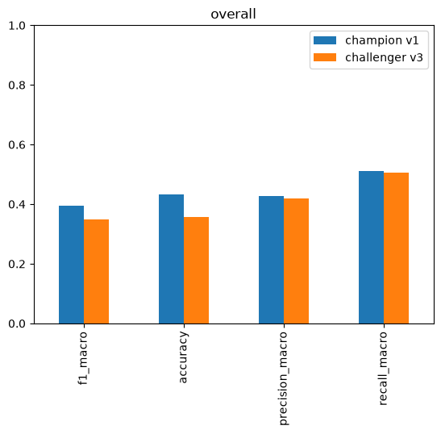
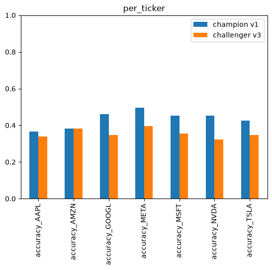
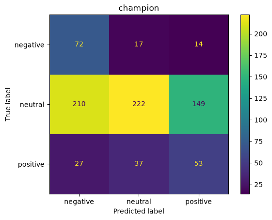
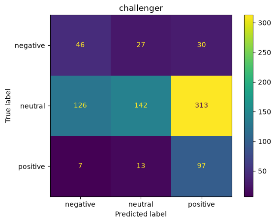
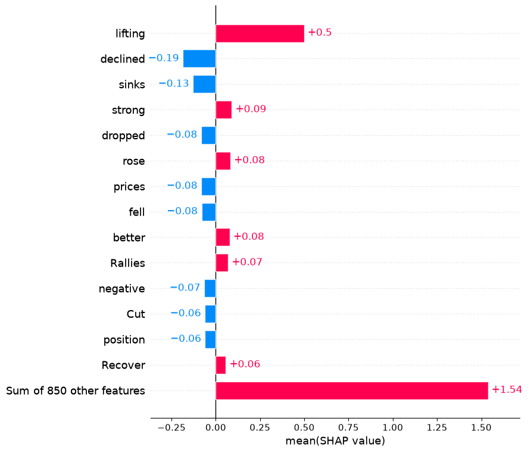
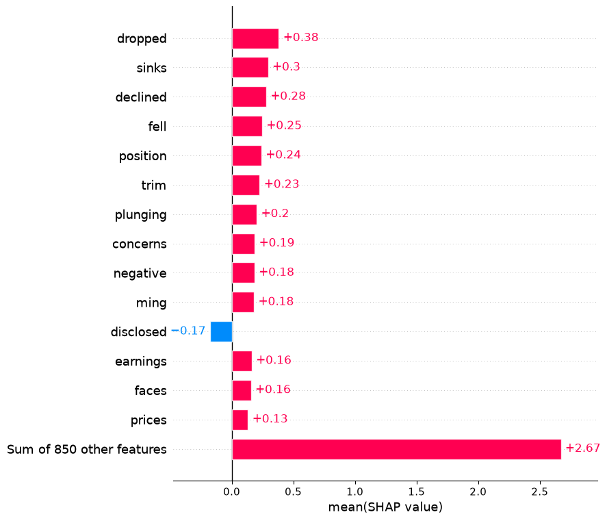
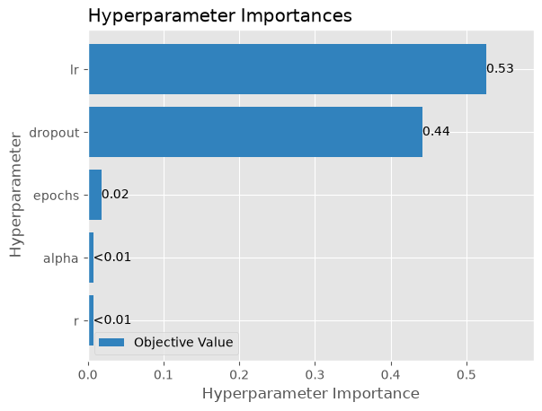

# How we covered the model development rubric

We went through the model development guidelines one point at a time and wrote down where each part lives in our repo. To set things up and run them, see the [README](../README.md).

> [!NOTE]
> All paths are from the root of the repo. The data pipeline is its own repo ([finmlops-data-pipeline](https://github.com/FinMLOps/finmlops-data-pipeline)), so this whole repo is the model and there's no extra `Model-Development/` folder.

> [!NOTE]
> We skipped the bias detection parts of the rubric (2.4, 2.5, 6, 7.3, 8.5 and 8.6). Our data is stock market news about 7 companies, with no people or demographic groups in it, the same reason we gave in the data pipeline submission. [`scripts/slices.py`](../scripts/slices.py) still writes a per-ticker, source, publisher and length report for every challenger, but we don't rely on it for any rubric point here.

All results below come from data snapshot `399df0ba` (the data pipeline's 11 Nov snapshot), run on an Apple M4 Pro on 15 Nov 2026, and from one run of the training workflow on GitHub Actions the same day.

## 2. Model development and ML code

### 2.1 Loading data from the data pipeline

The data pipeline publishes `news.parquet` with DVC to our Google Cloud Storage bucket. This repo imports it with `dvc import`, so we always train on a specific, versioned snapshot.

| What | Where |
|---|---|
| Which snapshot we use (the data pipeline commit is pinned as `rev_lock`) | [`data/news.parquet.dvc`](../data/news.parquet.dvc) |
| Get it | `uv run dvc pull` (move to the newest snapshot: `uv run dvc update data/news.parquet.dvc`) |
| Load and check it: expected columns and tickers, UTC times, scores between -1 and 1, empty and duplicate rows dropped | `load_news()` in [`scripts/data.py`](../scripts/data.py) |
| Labels from Marketaux's score (±0.15 cut-off), with the score removed so it can't leak into the input | `load_labeled()`, `score_to_label()` |
| Split by date with a 24-hour gap, never train on gold rows, drop training rows that repeat a test headline or URL | `split_by_date()`, `drop_gold()`, `drop_leaks()` |
| What the model reads: `TICKER (Company): headline + summary` | `model_input()` |
| Every MLflow run logs the snapshot it used | `data_info()` (`data_snapshot` param) |

`news.parquet` has 22,163 rows (one per article per ticker) from 1 Oct to 11 Nov 2026: 20,755 from Finnhub and 1,408 from Marketaux. Only Marketaux scores each ticker's sentiment, so that's where our training labels come from:

| Set | Data | Labels | Rows |
|---|---|---|---|
| Training | Marketaux before 5 Nov | Marketaux score | 870 (63% positive, 24% neutral, 13% negative) |
| Validation (best epoch, Optuna) | Marketaux, the newest 10% before 5 Nov | Marketaux score | 98 |
| Gap | the 24 hours before the test window | not used | |
| **Test that decides promotion** | **Gold set, 6 to 12 Nov, mostly Finnhub** | **LLM labels**, see below | 801 (72.5% neutral) |
| Secondary test | Marketaux, 6 to 12 Nov (frozen benchmark) | Marketaux score | 340 |

The model reads the ticker because 38% of Marketaux articles mention more than one ticker, and 138 of them have a different label per ticker. Without the ticker, the model would get the same text with two different answers.

> [!IMPORTANT]
> **The gold set was labeled by LLMs, not by hand.** We ran out of time to hand-label 801 rows, so Gemini 3.5 Flash (550 rows), Gemini 3.5 Flash-Lite (232, after the free quota ran out) and Qwen 2.5 7B through Ollama (19) labeled them, following written guidelines ([`PROMPT` in `scripts/llm_labels.py`](../scripts/llm_labels.py)). The model saw only each row's ticker, headline and summary, with web search off. Each row records which model labeled it (`labeled_by` in [`data/gold.csv`](../data/gold.csv)). The 120 rows marked `shared` are for checking the LLM against a person (`label_2`), which we haven't done yet.

### 2.2 Training and selecting the best model

| What | Where |
|---|---|
| Base model: [ProsusAI/finbert](https://huggingface.co/ProsusAI/finbert), pinned to one Hugging Face commit so the baseline can't change | `BASE`, `BASE_REVISION` in [`scripts/config.py`](../scripts/config.py) |
| Score pretrained FinBERT and register it as the first champion | `baseline()` in [`scripts/train.py`](../scripts/train.py) |
| Fine-tune with [LoRA](https://huggingface.co/docs/peft) adapters on the attention query and value layers (only those and the classifier head train) | `build_model()`, `fit()` |
| Hyperparameter search | `tune()`, see [section 3](#3-hyperparameter-tuning) |
| Train, validate, compare, promote or roll back, in one command | `run()` in [`scripts/pipeline.py`](../scripts/pipeline.py): `uv run python -m scripts.pipeline [--tune]` |
| Runs on an NVIDIA GPU (bf16/fp16), Apple Silicon GPU or CPU, picked automatically | [`scripts/hardware.py`](../scripts/hardware.py) |

The training loop uses cross-entropy weighted by inverse class frequency (the training labels are mostly positive), AdamW with weight decay 0.01, a 10% learning-rate warmup then linear decay, and gradient clipping at 1.0. After every epoch it scores the validation set and keeps the weights of the best epoch.

We compare two kinds of model: pretrained FinBERT as it is (the baseline), and FinBERT fine-tuned with LoRA under different settings (the default settings, and the best of the Optuna search). How one of them gets picked is in [section 4](#how-the-final-model-is-chosen).

### 2.3 Model validation

| What | Where |
|---|---|
| Metrics: macro F1 (main), macro precision and recall, accuracy, F1 per label, accuracy per ticker | `metrics()` in [`scripts/evaluate.py`](../scripts/evaluate.py) |
| Hold-out sets: the gold set (decides promotion) and the frozen benchmark, both from 6 to 12 Nov, which training never sees | `load_eval()`, `get()` in [`scripts/benchmark.py`](../scripts/benchmark.py) |
| The benchmark is saved once and never rebuilt, so every model is compared on the same rows | `data/benchmark_20261106_20261112.parquet` |
| Whether a gain is real: a paired bootstrap, 1,000 resamples, 95% interval | `f1_gain()` in [`scripts/evaluate.py`](../scripts/evaluate.py) |
| The validation threshold: macro F1 of at least 0.60 | `MIN_F1` in [`scripts/config.py`](../scripts/config.py), `decide()` in [`scripts/pipeline.py`](../scripts/pipeline.py) |

**Why macro F1.** The dashboard shows net sentiment (% positive − % negative) and the top positive and negative headlines, so the positive and negative calls are what matter. The gold set is 72.5% neutral: a model that always says "neutral" would get 0.725 accuracy while finding nothing. Macro F1 averages the three labels' F1 equally, so missing the rare positive and negative headlines counts as much as missing neutral ones.

### 2.6 Pushing the model to a registry

| What | Where |
|---|---|
| Every trained model is a new version in the MLflow model registry (`finbert-sentiment`), with the pinned `torch` and `transformers` versions | `log_model()` in [`scripts/registry.py`](../scripts/registry.py) |
| The model in use has the `champion` alias | `promote()`, `champion_version()` |
| Copy a version to Google Cloud Storage: `gs://finmlops-models/models/finbert-sentiment/v<N>/` | `push_to_gcs()` |
| Done automatically for a promoted challenger (before the alias moves) and for the first champion | `run()` in [`scripts/pipeline.py`](../scripts/pipeline.py), `baseline()` in [`scripts/train.py`](../scripts/train.py) |
| By hand | `uv run python -m scripts.registry push [VERSION]` |

The current champion, pretrained FinBERT (v1), is in the bucket: a complete MLflow model folder of 11 files, 418 MB (`MLmodel`, the weights, the tokenizer, a model card and the pinned requirements).

> [!NOTE]
> We used a Cloud Storage bucket rather than Artifact Registry because Artifact Registry stores container images and packages, while a model is a folder of files. The bucket is in the same Google Cloud project as our DVC bucket, and only the CI service account and the team can write to it.

## 3. Hyperparameter tuning

[Optuna](https://optuna.org) with its Bayesian sampler (TPE, seed 0), 10 trials, each one a nested MLflow run (`objective()` and `tune()` in [`scripts/train.py`](../scripts/train.py)). A trial is scored by macro F1 on the **validation** set, never on a test set. A trial whose loss becomes NaN is pruned and the search goes on.

| Hyperparameter | Search space | Best (trial 3) |
|---|---|---|
| Learning rate | 1e-5 to 5e-4, log scale | 4.0e-4 |
| LoRA rank `r` | 4, 8, 16 | 4 |
| LoRA alpha | 8, 16, 32 | 8 |
| LoRA dropout | 0.0 to 0.3 | 0.006 |
| Epochs | 2 to 4 | 3 |

Batch size (16), max length (256 tokens), weight decay, warmup and clipping stay fixed. The 10 trials scored 0.377 to 0.444 validation macro F1. Each data snapshot and label cut-off gets its own Optuna study (in `optuna.db`), so trials on old data never mix with new ones. Which hyperparameters mattered most is in [section 5](#5-model-sensitivity-analysis).

## 4. Experiment tracking and results

Every run is tracked in MLflow ([`scripts/registry.py`](../scripts/registry.py) `setup()`; open it with `uv run mlflow ui --backend-store-uri sqlite:///mlflow.db`):

| Run | What it logs |
|---|---|
| `baseline` | the model and revision, data snapshot, row counts, hardware; gold and benchmark metrics; how often Marketaux agrees with the gold labels; the registered version |
| `lora` | all hyperparameters, training and validation row counts, label sources, data snapshot, hardware; loss and validation F1 for every epoch; best epoch; validation and benchmark metrics; the registered version |
| `tune` | one nested `trial-N` run per trial, plus the best parameters and best validation F1 |
| `select-vN` | the decision (tag), both models' metrics, the gain and its 95% interval, the charts below |
| `sensitivity-vN` | the SHAP charts, F1 by input field, hyperparameter importance |

### Results

| Model | Macro F1 (gold, 801) | Accuracy (gold) | Macro F1 (benchmark, 340) | Validation macro F1 (98) | Decision |
|---|---|---|---|---|---|
| Pretrained FinBERT (v1) | **0.395** | **0.433** | 0.321 | | first champion |
| LoRA, default settings (v2) | 0.353 | 0.366 | 0.374 | 0.384 | failed validation |
| LoRA, best Optuna settings (v3) | 0.349 | 0.356 | 0.374 | 0.444 | failed validation |

| Challenger vs champion (gold) | Gain | 95% interval |
|---|---|---|
| v2 vs v1 | −0.043 | −0.075 to −0.012 |
| v3 vs v1 | −0.046 | −0.081 to −0.012 |

| Agreement with the gold labels | Rows | Agreement | Cohen's kappa |
|---|---|---|---|
| Marketaux's score (±0.15) | 101 | 26.7% | 0.059 (0.045 at ±0.10, 0.044 at ±0.25) |
| A person (`label_2` on the shared rows) | not done yet | | |

The fine-tuned models beat pretrained FinBERT on the benchmark (0.374 vs 0.321), whose labels come from Marketaux like the training labels, but lose on the gold set. Marketaux's labels and the gold labels agree at about chance level (kappa 0.06), so fine-tuning on Marketaux teaches the model Marketaux's labels, which are 63% positive, while the gold set is 72.5% neutral. The confusion matrices show it: v3 calls 313 of the 581 neutral gold headlines positive.

### How the final model is chosen

A challenger replaces the champion only if all three hold (`decide()` in [`scripts/pipeline.py`](../scripts/pipeline.py)):

1. **Validation:** macro F1 of at least 0.60 on the gold set, or the run fails (and CI goes red).
2. **A real gain:** the macro F1 gain stays above zero across the whole 95% interval. With a few hundred test rows, a gain of a couple of points can be luck.
3. **No ticker worse off:** not worse than the champion for any ticker (0.02 allowed, since some tickers have few rows).

Both challengers failed the first rule, so **the final model is pretrained FinBERT (v1)**. The pipeline did what it should: neither fine-tuned model was better, so neither replaced the champion.

*Champion v1 vs challenger v3 on the gold set: v3 is lower on every metric.*

*Accuracy per ticker: v3 is lower or equal for every ticker.*

| Champion (pretrained FinBERT) | Challenger (v3, best Optuna) |
|---|---|
|  |  |

*Confusion matrices on the gold set. Both models struggle with the neutral row (581 headlines). The champion splits its mistakes between negative (210) and positive (149). The challenger, trained on mostly positive Marketaux labels, calls 313 neutral headlines positive.*

## 5. Model sensitivity analysis

[`scripts/analysis.py`](../scripts/analysis.py) (`uv run python -m scripts.analysis`), run on the champion:

| Analysis | How | Result |
|---|---|---|
| Feature importance (words) | SHAP on 30 gold headlines (`PartitionExplainer`) | charts below |
| Input fields | macro F1 on the headline alone vs headline + summary | **0.460** vs 0.395 |
| Hyperparameters | Optuna's parameter importance (fANOVA) over the 10 trials | learning rate 0.53, dropout 0.44, epochs 0.02, alpha and `r` under 0.01 |

| Pushes toward positive | Pushes toward negative |
|---|---|
|  |  |

*Mean SHAP value per word. The strongest words make sense ("lifting", "rose", "strong" toward positive; "dropped", "sinks", "declined", "fell" toward negative). But neutral words like "position", "earnings" and "prices" also push toward negative, which matches the champion calling 210 neutral headlines negative.*

*Learning rate and dropout explain almost all of the difference between trials; LoRA rank and alpha barely matter.*

What we take from it:
- **The summary hurts.** Pretrained FinBERT does better on the headline alone (0.460) than with the summary added (0.395), probably because summaries are longer and more mixed, and FinBERT was trained on single sentences.
- **A future search** should spend its trials on learning rate and dropout, not on LoRA rank or alpha.

## 7. CI/CD pipeline automation

| Rubric point | How | Where |
|---|---|---|
| 7.1 Training on new code | GitHub Actions runs the tests, then the whole pipeline, on every push to `main` that changes model code, the data snapshot, the gold set or the dependencies, and by hand (optionally with `--tune`). It pulls the data with DVC using a Google Cloud service account (`GCP_SA_KEY` secret) | [`.github/workflows/train.yml`](../.github/workflows/train.yml) |
| 7.2 Automated validation | the pipeline scores the challenger on the gold set; below 0.60 macro F1 it exits with code 1 and the workflow fails | `decide()`, `main()` in [`scripts/pipeline.py`](../scripts/pipeline.py) |
| 7.4 Registry push | a promoted model is copied to `gs://finmlops-models` (`MODEL_BUCKET` repo variable) before it becomes the champion | `run()` in [`scripts/pipeline.py`](../scripts/pipeline.py) |
| 7.5 Notifications | every pipeline result and crash is emailed from the pipeline itself; the workflow also emails when training or the tests fail | `notify()` in [`scripts/pipeline.py`](../scripts/pipeline.py), the email steps in both workflows |
| 7.6 Rollback | if the challenger isn't better, the `champion` alias doesn't move; if the GCS upload fails, the alias doesn't move either | `decide()`, `run()`; `test_a_failed_upload_keeps_the_old_champion` |
| Tests on every push and PR | 83 offline tests | [`.github/workflows/pytest.yml`](../.github/workflows/pytest.yml) |
| Run record | the charts, reports, `mlflow.db` and `mlruns/` are uploaded as a build artifact of every run | `train.yml` |

**First CI run** ([run 43764391235](https://github.com/FinMLOps/finmlops-model-dev/actions/runs/43764391235), 15 Nov): the tests passed, the data was pulled from the DVC bucket with the service account, and training ran on CPU in 21 minutes. The challenger scored 0.354 against the champion's 0.395 (gain −0.041, 95% interval −0.075 to −0.011), so the run failed validation, the workflow went red, and the failure email went out. That's the expected result while our training labels don't match the gold labels.

> [!NOTE]
> Without a shared MLflow server (`MLFLOW_TRACKING_URI` secret), each CI run starts its own registry, scores pretrained FinBERT as its first champion and keeps the record only as a build artifact. Locally, the record is in `mlflow.db` on each laptop. The bucket is the one place every model that gets used ends up.

## 8. Code implementation

| Rubric point | Where |
|---|---|
| 8.1 Docker | [`Dockerfile`](../Dockerfile): Python 3.12 and the locked packages from `uv.lock`, CPU PyTorch; data, `.env` and the MLflow record are mounted at run time. `docker build -t finmlops-model .` takes about 2 minutes (a 5 GB image). |
| 8.2 Loading data from the data pipeline | [`scripts/data.py`](../scripts/data.py), [`data/news.parquet.dvc`](../data/news.parquet.dvc) ([2.1](#21-loading-data-from-the-data-pipeline)) |
| 8.3 Training and selecting the best model | [`scripts/train.py`](../scripts/train.py), [`scripts/pipeline.py`](../scripts/pipeline.py) ([2.2](#22-training-and-selecting-the-best-model), [4](#how-the-final-model-is-chosen)) |
| 8.4 Model validation | [`scripts/evaluate.py`](../scripts/evaluate.py), [`scripts/benchmark.py`](../scripts/benchmark.py) ([2.3](#23-model-validation)) |
| 8.7 Pushing to a registry | [`scripts/registry.py`](../scripts/registry.py) ([2.6](#26-pushing-the-model-to-a-registry)) |

### Tests

83 tests with pytest, all offline: no model downloads, no API calls, no real emails (a tiny stand-in model, fake MLflow and GCS clients). [`pytest.yml`](../.github/workflows/pytest.yml) runs them on every push and PR to `main`.

| File | Tests | What they check |
|---|---|---|
| [`tests/test_data.py`](../tests/test_data.py) | 17 | loading and checking `news.parquet`, labels from scores, the date split, no gold rows or repeated stories in training, the gold set file, sampling rows to label, the ticker in the input |
| [`tests/test_train.py`](../tests/test_train.py) | 12 | class weights, the training loop learns and keeps the best epoch, NaN loss stops it, diverged Optuna trials are skipped, when LLM labels may join training, the first champion goes to GCS before it's promoted |
| [`tests/test_pipeline.py`](../tests/test_pipeline.py) | 12 | the promotion rule (fail, keep, promote), emails, a failed upload keeps the old champion, a crash emails the traceback, exit code 1 on failed validation |
| [`tests/test_registry.py`](../tests/test_registry.py) | 9 | "no champion" vs a server error, pinned requirements, uploading every file to GCS, the push command |
| [`tests/test_llm_labels.py`](../tests/test_llm_labels.py) | 9 | the LLM labeler: only text goes in, no web search, bad answers skipped, resuming, retries |
| [`tests/test_benchmark.py`](../tests/test_benchmark.py) | 7 | freezing the benchmark once, labels follow the cut-off, agreement numbers |
| [`tests/test_evaluate.py`](../tests/test_evaluate.py) | 5 | metrics, the per-ticker rule, our macro F1 matches scikit-learn, the bootstrap interval |
| [`tests/test_hardware.py`](../tests/test_hardware.py) | 4 | device order, forcing a device, mixed precision only on NVIDIA |
| [`tests/test_ollama_gold.py`](../tests/test_ollama_gold.py) | 4 | the local LLM labeler never overwrites existing labels |
| [`tests/test_analysis.py`](../tests/test_analysis.py) | 2 | the charts get written |
| [`tests/test_slices.py`](../tests/test_slices.py) | 2 | the slice report |

## What comes next

The fine-tuned model can't beat pretrained FinBERT while it learns from Marketaux's labels and is judged on the gold labels. We tested this in [PR #2](https://github.com/FinMLOps/finmlops-model-dev/pull/2) by training on the older gold rows instead and judging on the newest 262: the fine-tuned model went from clearly worse to level with pretrained FinBERT (0.421 vs 0.425), but not better, because 332 training rows (39 positive, 42 negative) are too few.

So the next steps are:

1. **Check the gold labels against a person.** Hand-label the 120 `shared` rows into `label_2` and run `uv run python -m scripts.benchmark` to see how often Gemini agrees with us.
2. **More training labels like the gold ones.** Label the Finnhub training rows with the same LLM and prompt (`uv run python -m scripts.llm_labels train`), which gives thousands of rows instead of 870.
3. **Train on the headline alone,** since that already lifts pretrained FinBERT from 0.395 to 0.460.
4. **Search learning rate and dropout** with more trials once the labels are fixed.
