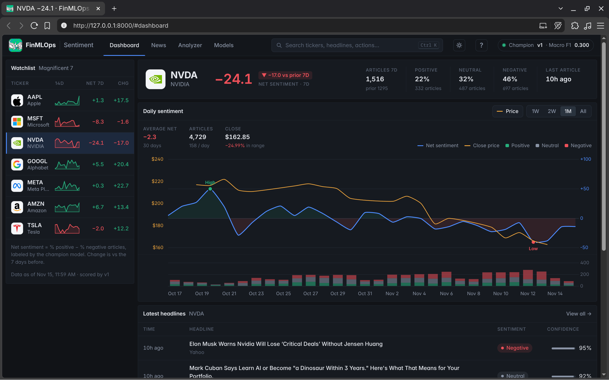

# UI setup

The dashboard shows the champion model's labels on the news from the data pipeline.



## Quick start: the real data is in the repo

We pushed the two files the dashboard reads, so you can view the real-data dashboard right after cloning, with no Google Cloud access, data download or model:

- `outputs/predictions.parquet`: 24,414 articles (1 Oct to 15 Nov 2026) labeled by the champion, pretrained FinBERT (v1)
- `outputs/prices.parquet`: daily closing prices up to 13 Nov 2026

```bash
git clone https://github.com/FinMLOps/finmlops-model-dev.git
cd finmlops-model-dev
uv sync --extra cpu                          # or --extra gpu on an NVIDIA machine
uv run python -m frontend.server             # http://localhost:8000
```

Stop the server with Ctrl+C. Change the address with `HOST` and `PORT` in `.env`.

The Dashboard and News tabs work with just these two files. The Analyzer, the Models tab and the word-by-word explanation when you open a headline run the model, so they need a champion in your local MLflow registry: see [Label the news yourself](#label-the-news-yourself).

## Label the news yourself

To get newer news, or labels from another model, label the articles on your own machine. This rewrites both files in `outputs/`; commit them again only if the dashboard data in the repo should change.

> [!IMPORTANT]
> You need access to the `finmlops-pipeline-dvc` bucket on Google Cloud and the Google Cloud CLI (for `gcloud auth`), since the news comes from there.

### First time

In the repo you cloned above:

```bash
gcloud auth application-default login
uv run dvc pull                              # data/news.parquet
uv run python -m scripts.train baseline      # registers pretrained FinBERT as the champion (skip if you already have one)
```

### Label and run

```bash
uv run python -m frontend.server score       # label every article with the champion -> outputs/predictions.parquet
uv run python -m frontend.server prices      # daily closes from Yahoo Finance -> outputs/prices.parquet (optional)
uv run python -m frontend.server             # http://localhost:8000
```

### Get newer news

```bash
uv run dvc update data/news.parquet.dvc      # latest data pipeline snapshot
uv run python -m frontend.server score
uv run python -m frontend.server prices
```

A running server picks up the new files without a restart.

> [!WARNING]
> Commit `data/news.parquet.dvc` only through a PR: a change to it on `main` starts the training workflow.

## Notes

- The dashboard shows the champion's labels. After a new champion is promoted, run `score` again.
- `score` takes about 2 minutes on an Apple M4 Pro for about 24,000 articles.
- Prices exist only for trading days, so weekends and holidays have no price.
- The UI files are in `frontend/static/`: edit them and refresh the browser to see changes.

## Problems

| Error | Fix |
|---|---|
| `No predictions yet` in the browser | `outputs/predictions.parquet` is missing: `git pull`, or `uv run python -m frontend.server score` |
| `no champion registered yet` | `uv run python -m scripts.train baseline` |
| `news.parquet not found` | `uv run dvc pull` |
| `dvc pull` hangs or is denied | `gcloud auth application-default login`, and ask for bucket access |
| Port 8000 in use | set `PORT=8001` in `.env` |
